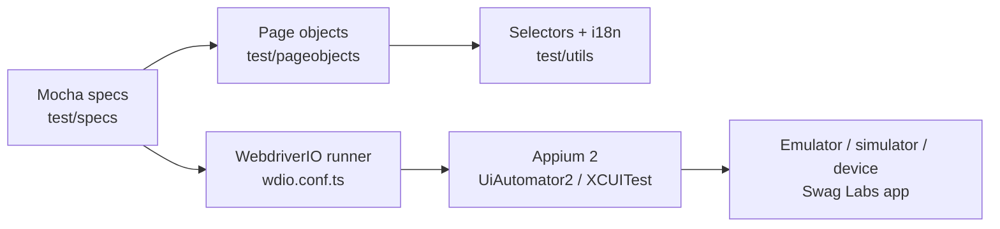

# Swag Labs Mobile Tests (WebdriverIO + Appium + TypeScript)

[](https://github.com/rciesielski3/saucelabs-mobile-test/actions/workflows/ci.yml)

Mobile UI end-to-end tests for the Sauce Labs **Swag Labs** sample app (Android and iOS), written with WebdriverIO, Mocha, Appium 2 and TypeScript using the Page Object pattern.

Despite the repository name, the tests **run locally against Appium** on an emulator, simulator or device. They do not use the Sauce Labs cloud and need no Sauce account or credentials.

## Architecture



## Prerequisites

- Node.js 22 or newer (`.nvmrc` provided: `nvm use`)
- Android: Android Studio with an emulator (or a device), `ANDROID_HOME` set
- iOS (macOS only): Xcode with a simulator
- Appium drivers are installed as npm dev dependencies, no global Appium needed

## Setup

```bash
npm ci
```

### Get the Swag Labs app

The app binaries are not committed (`assets/` is git-ignored). Download them from the official releases: https://github.com/saucelabs/sample-app-mobile/releases

- Android: put the `.apk` in `assets/android/`
- iOS: put the simulator `.app` (or its `.zip`) in `assets/ios/`

The first file found in the folder is used. If the folder is missing, the run stops with a clear error message.

### Configuration

`npm run test:android` and `npm run test:ios` set `PLATFORM` and `APP_FOLDER` for you, so no `.env` is required. To override the device or platform version, copy `.env.example` to `.env` and edit it (real environment variables take precedence over `.env`).

## Running tests

Start an Android emulator or iOS simulator first, then:

```bash
npm run test:android
npm run test:ios
```

The test language follows the device `language`/`locale` capability (`en` default; `de`, `es`, `nl` supported) and is set in `beforeSession()`. The inline environment variables in the scripts need a POSIX shell (macOS, Linux, WSL).

## Scripts

| Script                 | What it does                            |
| ---------------------- | --------------------------------------- |
| `npm run test:android` | Run all specs on Android                |
| `npm run test:ios`     | Run all specs on iOS                    |
| `npm run lint`         | ESLint (typescript-eslint, flat config) |
| `npm run format`       | Prettier, write                         |
| `npm run format:check` | Prettier, check only                    |
| `npm run typecheck`    | `tsc --noEmit`                          |

## Specs

| File                      | Covers                                                                          |
| ------------------------- | ------------------------------------------------------------------------------- |
| `login-validation.e2e.ts` | Login screen elements, empty credentials, empty password, wrong credentials (4) |
| `login-success.e2e.ts`    | Valid login lands on the Products screen (1)                                    |
| `add-to-cart.e2e.ts`      | Add an item to the cart                                                         |
| `remove-from-cart.e2e.ts` | Add/remove toggle                                                               |
| `filter-products.e2e.ts`  | Product sorting by name and price                                               |
| `checkout.e2e.ts`         | Full checkout flow                                                              |

## Project structure

```
.
├── .github/workflows/ci.yml   # static checks
├── assets/                    # app binaries (git-ignored)
├── config/                    # Appium capabilities (android.config.ts, ios.config.ts)
├── test/
│   ├── pageobjects/           # LoginScreen, ProductsScreen, CartScreen, checkout/*
│   ├── specs/                 # *.e2e.ts
│   └── utils/                 # i18n.ts, selectors.ts, users.ts, waitForElements.ts
├── .env.example
├── eslint.config.mjs
├── tsconfig.json
└── wdio.conf.ts
```

## CI and limitations

CI (GitHub Actions, Ubuntu 24.04, Node 22) runs lint, format check, type check and a non-blocking `npm audit` for production dependencies. The badge reflects these **static checks only**.

The E2E tests are **not run in CI**. Android emulators on hosted runners need KVM, start slowly and are flaky, and iOS needs much pricier macOS runners. Tests run with `transpileOnly`, so the type check in CI is the only compile-time gate. The tests have not been verified against the latest Swag Labs app release, so selectors may need updating.

## License

MIT. Created by [Rafał Ciesielski](https://github.com/rciesielski3).
